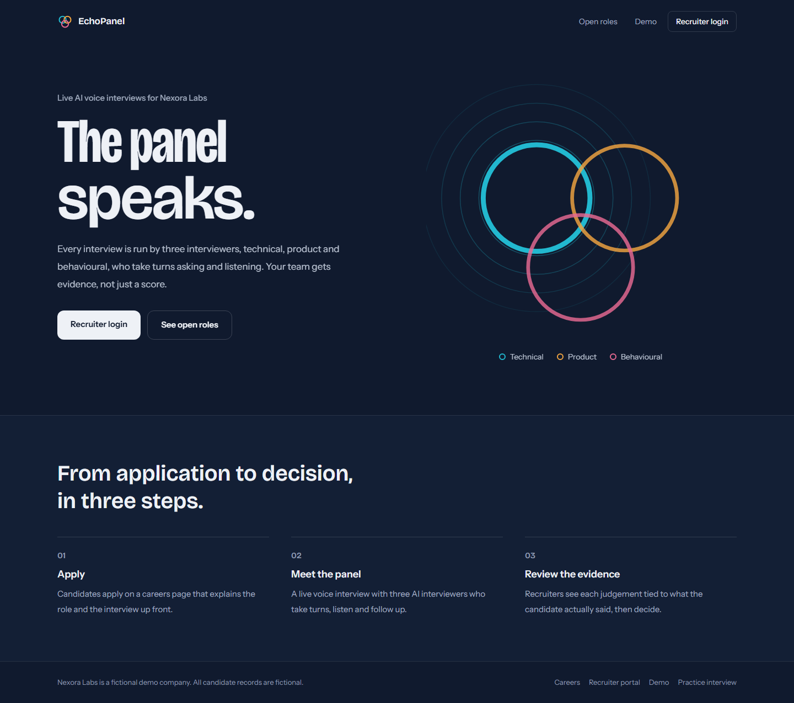
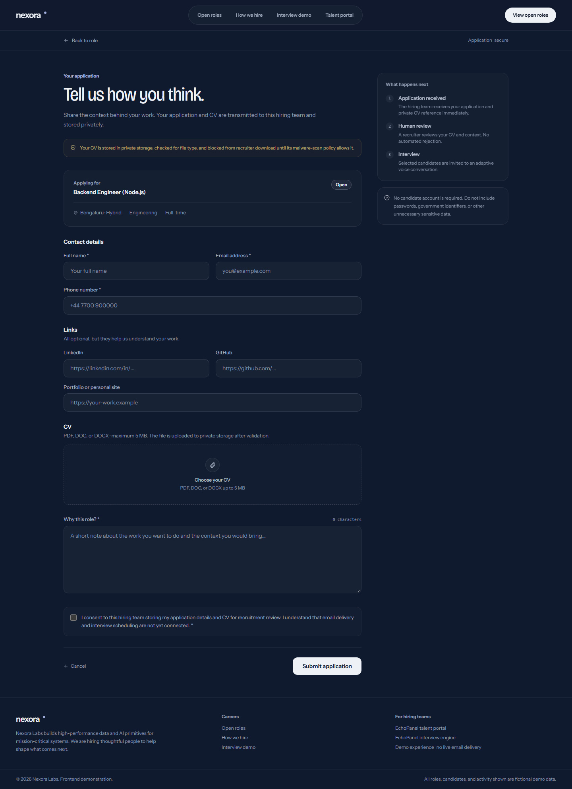
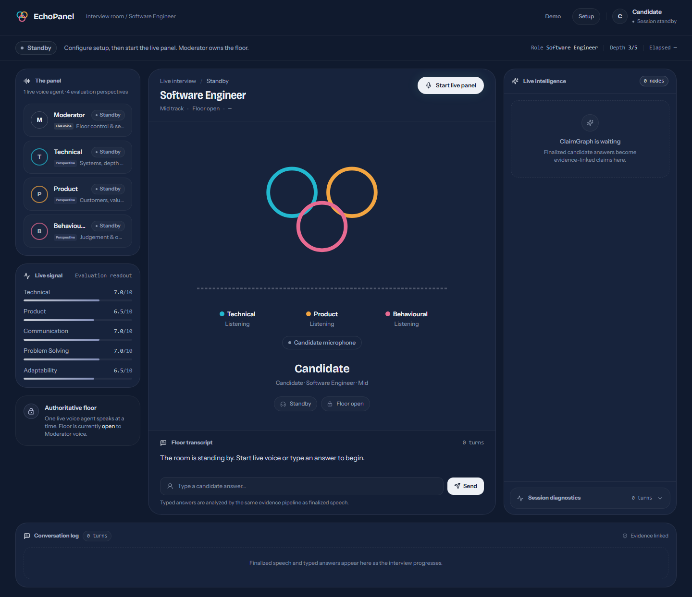
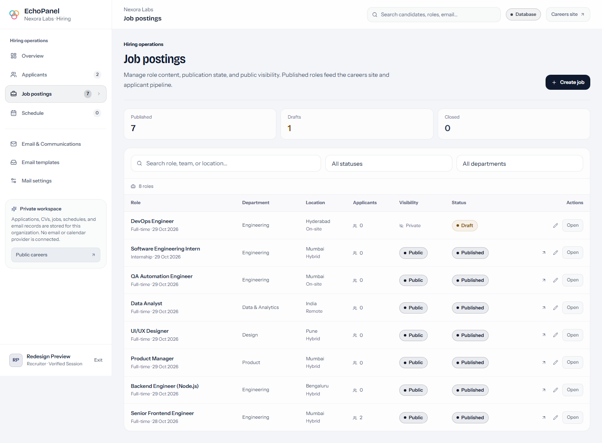
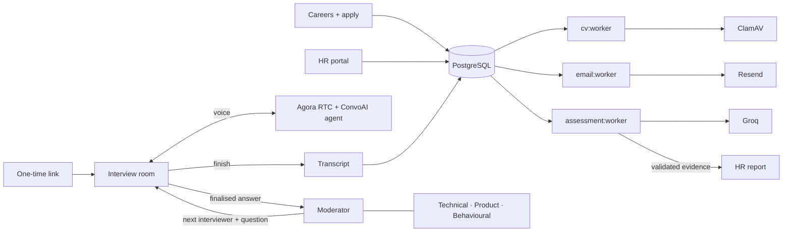

# EchoPanel

Live AI voice interviews with a panel of three. A candidate applies on a careers page, the hiring team shortlists and schedules them, and the candidate joins a live voice interview where a **Technical**, a **Product** and a **Behavioural** interviewer take turns, coordinated by a **Moderator**. The transcript is assessed by an LLM against a fixed rubric, and every judgement in the HR report is tied to a quote from what the candidate actually said.



The demo company is **Nexora Labs**, a fictional organisation; all jobs and candidate records in the screenshots are fictional.

## The flow

1. **Careers.** HR creates and publishes jobs in the portal; published jobs appear on the public careers page with search and filters.
2. **Apply.** The candidate submits contact details, optional LinkedIn/GitHub/portfolio links, a CV (PDF, DOC or DOCX, checked by file signature) and consent. They receive an *application received* email.
3. **CV scan.** The CV goes to private storage and a durable scan job; the `cv:worker` scans it with ClamAV. Recruiters can download only `CLEAN` files; infected files are quarantined and deleted.
4. **Shortlist.** HR reviews the applicant, opens the CV, adds notes and moves the application through stages. Every change is recorded as an application event.
5. **Schedule.** HR schedules the interview with an explicit IANA timezone (default `Asia/Kolkata`); times in the past are rejected.
6. **One-time invite email.** Scheduling issues a single-use, hashed join link (72 h) and queues one *interview invitation* email. The link is rendered from `APP_PUBLIC_URL` at send time and the token is never stored.
7. **Live AI voice interview.** The candidate redeems the link into a session scoped to that one interview (it cannot reach any HR API) and joins the room over Agora RTC. After each answer the **Moderator** decides which interviewer speaks next. A timeline contradiction goes to Behavioural, a vague answer to Technical and missing business impact to Product; otherwise it closes competency gaps or rotates the panel. The opening question is built from the job description; the plan is eight answers, with a CV question after #2, a GitHub/LinkedIn question after #5 and a neutral closing after #8. Only one interviewer speaks at a time.
8. **Transcript.** When the candidate ends the interview, the finalised turns are stored as a versioned, checksummed transcript, the candidate session and link are revoked, the interview is marked `Completed`, an assessment job is queued and an *interview completed* email is sent.
9. **Groq assessment.** The `assessment:worker` sends the transcript and rubric to Groq (`openai/gpt-oss-120b`, JSON mode). It scores five dimensions (technical depth, product judgement, communication, problem solving, adaptability), and every evidence quote must match a real candidate turn. Invalid output is retried once, and a dimension with no evidence is reported as *Insufficient evidence* rather than guessed.
10. **HR report.** The interview page always links to the report and labels its state (*provider not configured*, *pending*, *failed: reason*, or ready). The report shows the overall score, per-dimension scores with confidence, strengths, risks, unresolved concerns, the evidence quotes and a recommendation (*Strong Hire* to *Needs Review*). Its review status stays *Pending* until a recruiter reviews it.

| Apply | Live interview room |
|---|---|
|  |  |



## Tech stack

| Area | Technology |
|---|---|
| Web app | Next.js 14 (App Router), React 18, TypeScript, Tailwind CSS |
| Data | PostgreSQL with Prisma 6 |
| Auth | Better Auth (HR credential login, no public sign-up); separate scoped candidate sessions |
| Live voice | Agora RTC + RTM, Agora Conversational AI Engine (`agora-agents`, published AI Studio pipeline) |
| Assessment | Groq OpenAI-compatible chat completions (`openai/gpt-oss-120b`); OpenAI Responses also supported |
| Email | Resend, through a transactional outbox and `email:worker` |
| CV scanning | ClamAV (INSTREAM) through a durable queue and `cv:worker` |
| Calendar | Google Calendar OAuth (PKCE) and `calendar:worker`, optional |
| Testing/CI | Vitest, Playwright, GitHub Actions |

## Architecture



A single Agora voice agent speaks for the whole panel. The Moderator (`lib/orchestrator.ts`, called through `/api/interview/analyze`) picks the interviewer and question, and the room has the agent speak it through `/api/interview/speak`. The UI shows which interviewer has the floor.

## What was verified end to end

All verification ran on a local machine against the `ecopanel_test` database, with the app exposed over a public HTTPS tunnel and the candidate on a phone.

- **Full journey test (28 Oct 2026).** Recruiter login, create and publish a job, apply with a CV from a phone, ClamAV scan `CLEAN`, review and shortlist, schedule, issue the one-time link, redeem on the phone, live AI interview (seven answers, nine distinct questions, CV and GitHub/LinkedIn questions at the planned points, one neutral closing), end the interview (transcript stored, candidate session revoked, link reuse rejected) and HR transcript view. Candidate cookies got `401` on every HR route. Details and the fixes that followed are in [`docs/AUDIT.md`](docs/AUDIT.md).
- **Live run with workers (29–30 Oct 2026).** CVs scanned `CLEAN` by the real ClamAV worker; candidate emails (application received, interview invitation, interview completed) accepted by Resend in test mode; a Groq assessment generated from a real interview transcript and shown in the HR report with evidence quotes.
- **Presented live on 30 Oct 2026** from the same setup ([`docs/DEMO_RUNBOOK.md`](docs/DEMO_RUNBOOK.md)).
- **Automated checks.** `npm run typecheck` and `npm run lint` are clean. `npm test` passes 318 tests; 39 are skipped by default because they need a test database or a real ClamAV daemon (see [Testing](#testing)).

Not verified: Resend in live mode with a verified sender domain, delivery/bounce webhooks against Resend (so `Sent` means accepted, not delivered), and live Google Calendar sync.

## Known limitations

- **Voice recognition depends on the room and the network.** Background noise, a weak microphone or an unstable connection cause recognition errors or delayed turns. The room merges speech segments into one answer until the candidate has been quiet for 1.5 s (end-of-turn silence is 900 ms). If voice is unreliable, the candidate can **type an answer** in the room; typed answers go through the same pipeline as speech.
- **One voice for the panel.** The three interviewers are perspectives voiced by one Agora agent, distinguished on screen by colour and label, not by separate voices.
- **Assessments are AI-assisted and need human review.** Scores are only as good as the transcript; short or vague interviews produce low-confidence or *Insufficient evidence* dimensions. No hiring decision is automated.
- **Email ran in test mode only.** With `EMAIL_MODE=test` every message goes to `EMAIL_TEST_RECIPIENT`. Live mode needs a verified sender domain (SPF/DKIM/DMARC).
- **Google Calendar** is implemented and tested with fake providers but was never run against a real Google account.
- **Not production-hardened.** CVs are on the local filesystem; there are no backups, retention/deletion policy, metrics or alerting, and no worker supervision. A user with several organisation memberships gets the earliest one. Re-applying with the same email does not update an existing candidate's links.
- **Free-tier Groq limits** can delay or fail an assessment; failures are shown in the report and can be retried from HR.

## Setup

Requirements: Node.js (developed and tested on 22), Docker (PostgreSQL and ClamAV), and accounts for Agora, Groq and Resend for the full flow.

1. **Install.**

   ```bash
   npm install
   ```

2. **Configure.** Copy `.env.example` to `.env.local` and fill in the values. `.env.example` lists every variable with comments; real env files (`.env`, `.env.local`, `.env.*.local`) are git-ignored and must never be committed.

   | Group | Variables |
   |---|---|
   | Core | `APP_DATA_MODE=database`, `DATABASE_URL`, `AUTH_SECRET` (32+ random characters), `NEXT_PUBLIC_APP_URL`, `APP_PUBLIC_URL` (public HTTPS URL used in candidate links) |
   | CV storage and scanning | `CV_STORAGE_DIR`, `CV_SCANNER_PROVIDER=clamav`, `CV_CLAMAV_HOST`, `CV_CLAMAV_PORT` |
   | Live interview | `AGORA_APP_ID`, `AGORA_APP_CERTIFICATE`, `AGORA_PIPELINE_ID`, optional `AGORA_AREA` (`US`/`EU`/`AP`) and `AGORA_CHANNEL_PREFIX` |
   | Assessment | `ASSESSMENT_PROVIDER=groq`, `GROQ_API_KEY`, optional `GROQ_ASSESSMENT_MODEL` (default `openai/gpt-oss-120b`) |
   | Email | `EMAIL_PROVIDER=resend`, `EMAIL_MODE=test` or `live`, `RESEND_API_KEY`, `EMAIL_FROM`, `EMAIL_TEST_RECIPIENT`, optional `EMAIL_WEBHOOK_SECRET` |
   | Calendar (optional) | `CALENDAR_PROVIDER=google`, `GOOGLE_CALENDAR_CLIENT_ID`, `GOOGLE_CALENDAR_CLIENT_SECRET`, `GOOGLE_CALENDAR_REDIRECT_URI`, `CALENDAR_TOKEN_ENCRYPTION_KEY` |

   Without `APP_DATA_MODE=database` the app runs in **demo mode**: browser-memory data and a deterministic interview at `/demo`, with no external services. Database mode never falls back to demo data. Missing configuration returns an explicit error.

3. **Start PostgreSQL and ClamAV.** Put `POSTGRES_USER`/`POSTGRES_PASSWORD` in an ignored `.env.postgres.local`. ClamAV takes a few minutes to load its signatures on first start.

   ```bash
   docker compose --env-file .env.postgres.local -f compose.phase2a.yml up -d postgres clamav
   ```

4. **Create the schema, seed templates and the first HR owner.**

   ```bash
   npx prisma migrate deploy
   npm run db:seed
   BOOTSTRAP_ADMIN_EMAIL=owner@example.com \
   BOOTSTRAP_ADMIN_PASSWORD='<12+ characters>' \
   BOOTSTRAP_ADMIN_NAME='HR Owner' \
   npm run bootstrap:admin
   ```

5. **Run the app and the workers**, each in its own terminal:

   ```bash
   npm run dev                 # http://localhost:3000
   npm run cv:worker
   npm run email:worker
   npm run assessment:worker
   npm run calendar:worker     # only if Google Calendar is configured
   ```

6. **Use it.** Sign in at `/hr/login`, create and publish a job, apply at `/careers`, then shortlist and schedule from the portal. Candidate links need a public HTTPS `APP_PUBLIC_URL`, and phones only allow microphone access over HTTPS, so expose the app through a tunnel (the demo used Tailscale Funnel; see [`docs/DEMO_RUNBOOK.md`](docs/DEMO_RUNBOOK.md)).

### Agora configuration

1. In Agora Console, create or select a project with an App Certificate and enable the Conversational AI Engine.
2. Publish an AI Studio pipeline and put its ID in `AGORA_PIPELINE_ID`. Configure its STT, LLM and TTS providers in the Console; any vendor keys belong only in the pipeline configuration or server environment.
3. `/api/agora/token` issues an RTC+RTM token, `/api/agora/start` starts the ConvoAI agent, and the room joins RTC, publishes the microphone, plays the agent's audio and reads RTM transcript events. The App Certificate never reaches the browser. Candidate interruption is enabled through VAD.

## Testing

```bash
npm run typecheck
npm run lint
npm test                                   # unit tests; DB and ClamAV suites skip themselves
TEST_DATABASE_URL=postgresql://... npm test   # adds the PostgreSQL integration suites (disposable database)
CV_CLAMAV_INTEGRATION=1 npm run test:scanner:real   # real ClamAV: clean PDF and EICAR
npm run test:e2e                           # Playwright against an isolated _e2e database
```

The unit suite covers the Moderator and live-flow regressions (answer merging, interrupt gating, question plan), transcript and evidence validation, the Groq and OpenAI providers (mocked), invitations and candidate-session isolation, email outbox and webhooks, calendar sync, timezone/DST handling, rate limiting, CV validation and the scan queue.

The Playwright suite builds into `.next-e2e`, runs the app on `3201` with a deterministic test scanner on `3311` and a real `cv-worker` on `3312`, and wipes and reseeds its own `_e2e` database and storage. Copy the E2E block from `.env.example` into an ignored `.env.e2e.local` first. It covers submission, scanning and download, stage changes and notes, infected-CV blocking, duplicates, validation, recruiter auth, organisation isolation, job publishing, scheduling, honest report absence and queued email; it starts no email, calendar or AI provider.

GitHub Actions runs typecheck, lint, unit tests and the production build, the PostgreSQL integration tests with migrations, the Playwright suite, and a real-ClamAV job.

## Technical reference

### CV storage and scanning

CVs are stored privately under `CV_STORAGE_DIR` (default `var/cv-storage`, git-ignored) with random keys, `0o700`/`0o600` permissions and SHA-256 checksums re-verified before download. The upload enqueues a `CvScanJob` in the same transaction and returns without waiting for the scan. Only `CLEAN` files can be downloaded; `PENDING`, `INFECTED`, `SCAN_FAILED` and `UNSCANNED` are blocked. `CV_ALLOW_UNSCANNED_DOWNLOADS=true` allows only `UNSCANNED`, and only outside production.

The worker claims jobs with `FOR UPDATE SKIP LOCKED`, renews leases, recovers abandoned jobs, retries with exponential backoff (5 attempts), fails closed on scanner errors and shuts down gracefully. `npm run cv:scan-retry -- --requeue-failed` backfills or requeues. An HTTP scanner can replace ClamAV with `CV_SCANNER_PROVIDER=http`, `CV_SCANNER_URL` and optional `CV_SCANNER_TOKEN`; it must return `{"status":"clean"}` or `{"status":"infected"}`.

### Email

Candidates receive exactly three emails: application received, one interview invitation carrying the one-time link, and interview completed. Messages are written to the outbox in the same transaction as the business change. Lifecycle: `Draft → Queued → Sending → Sent` when Resend accepts. `Delivered`, `Bounced` and `Complained` need a verified webhook at `POST /api/webhooks/resend` (`EMAIL_WEBHOOK_SECRET`). Transient failures retry with backoff. An ambiguous send is marked `Failed` (`AMBIGUOUS_SEND`) and never retried automatically, to avoid duplicates. `npm run email:status -- <id>` reads Resend's last event for one message (against `.env.live.local`).

### Assessment

The prompt and rubric are versioned (`lib/server/assessment/rubric.ts`). Jobs are leased and retried by the worker, and provider `401/403/404` responses surface in HR as "misconfigured (check the API key and model)". Each assessment stores provenance (provider, model, transcript version) and a review status that starts as `Pending`. `npm run assessment:run-one -- <job id>` processes a single job against `.env.live.local`.

### Google Calendar (optional)

OAuth uses PKCE S256 with a one-time state bound to the HR user, organisation and session. Tokens are encrypted with AES-256-GCM, and `CALENDAR_TOKEN_ENCRYPTION_KEY_PREVIOUS` supports key rotation. Generate a key with `node -e "console.log(require('crypto').randomBytes(32).toString('base64'))"`. Events use deterministic IDs, so creates are idempotent, and email and calendar attendee notifications are separate opt-in choices. Connect from `/hr/schedule`.

### Security and observability

HR APIs require a Better Auth session and organisation membership, and every query is organisation-scoped. Candidate sessions cover one interview only. Sensitive routes use a PostgreSQL-backed rate limiter that holds across processes and fails closed (`503`). Proxy headers are trusted only with `TRUSTED_PROXY_HEADERS=true`. `GET /api/health/live` reports liveness, and `GET /api/health/ready` returns `503` when the database or CV storage is unavailable (scanner outages report `degraded`). Logs are single-line JSON with request IDs; emails, credentials, database URLs and CV content are redacted.

### API routes

- **Public:** `GET /api/careers/jobs`, `GET /api/careers/jobs/[id]`, `POST /api/careers/applications`, `GET /api/careers/applications/[reference]`, `POST /api/webhooks/resend`, `GET /api/health/live`, `GET /api/health/ready`.
- **Candidate:** `POST /api/candidate/invitations/redeem`, `POST /api/candidate/interview/finish`.
- **Interview room:** `GET /api/agora/session`; `POST /api/agora/token`, `/start`, `/stop`; `POST /api/interview/analyze`, `/speak`, `/interrupt`, `/assess`.
- **HR:** `/api/hr/applications` (+ `[id]`, `/stage`, `/notes`), `/api/hr/cv/[id]`, `/api/hr/jobs` (+ `[id]`, `/status`), `/api/hr/interviews` (+ `options`, `[id]`, `/cancel`, `/complete`, `/invitation`, `/transcript`, `/assessment`, `/assessment/retry`, `/assessment/review`), `/api/hr/email/messages` (+ `[id]`, `/retry`), `/api/hr/email/templates` (+ `[id]`), `/api/hr/email/settings`, `/api/hr/calendar/connection`, `/connect`, `/google/callback`, `/events/[id]/retry`.
- **Auth:** Better Auth at `/api/auth/[...all]`.

## Governance

Assessments are AI-assisted and meant for human review. Every score is backed by verbatim candidate quotes, or marked as having insufficient evidence. There is no scraping, no biometric or emotion scoring, and no autonomous hiring decision. The public verification page excludes transcript text.

## Further documentation

- [`docs/DEMO_RUNBOOK.md`](docs/DEMO_RUNBOOK.md): running the live demo (start/check/stop scripts, workers, rollback, tunnel).
- [`docs/AUDIT.md`](docs/AUDIT.md): journey test results and the fixes that followed.
- [`docs/CURRENT_PROJECT_HANDOVER.md`](docs/CURRENT_PROJECT_HANDOVER.md), [`docs/CURRENT_STATUS_AUDIT.md`](docs/CURRENT_STATUS_AUDIT.md): earlier audits (27 Oct 2026), kept for history; the README supersedes them where they differ.
