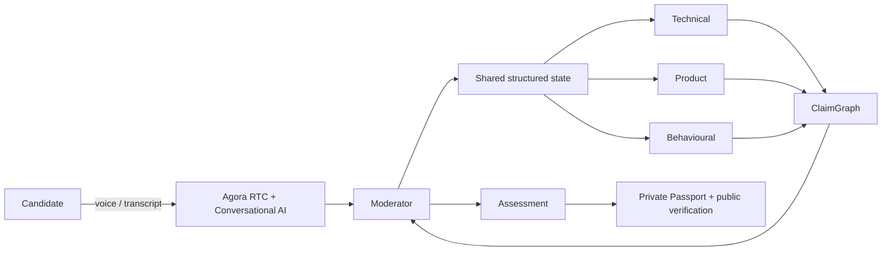

# EchoPanel

Adaptive, multi-agent interview rooms where candidate answers drive the next question. The polished MVP prioritizes the live **ClaimGraph Crossfire** demo: technical evidence is accepted, missing business impact causes the Product interviewer to request the floor, and the assessment stays linked to evidence.

## Run locally

```bash
npm install
npm run dev
npm run test
npm run typecheck
npm run build
```

Open `http://localhost:3000`. The deterministic judge-ready flow is at `/demo`; it runs without external services. The real Agora path is `/live` and never falls back to simulated audio. Demo candidate: **Alex Sharma**, target role: **Software Engineer**. There are no seeded login credentials because this prototype does not pretend to implement an authentication provider.

## Environment

Copy `.env.example` to `.env.local`. `AGORA_APP_ID`, `AGORA_APP_CERTIFICATE`, and `AGORA_PIPELINE_ID` are required for live Agora mode. `AGORA_AREA` is optional (`US`, `EU`, or `AP`; defaults to `US`) and `AGORA_CHANNEL_PREFIX` is optional. `AGORA_AGENT_TOKEN` is not consumed by the current official SDK path because `agora-agents` generates ConvoAI auth from the App ID and App Certificate. MongoDB and OAuth values are intentionally optional in this focused demo build; job-platform adapters return a transparent verification-link fallback until official approval and credentials exist.

## Agora configuration

1. In Agora Console, create/select a project with an App Certificate and enable Conversational AI Engine (for older projects, verify it on the RTC Services page).
2. Publish an AI Studio pipeline and place its ID in `AGORA_PIPELINE_ID`. Configure its STT, LLM, and TTS providers in the Console; Agora-managed models need no vendor key, while BYOK values belong only in the server environment/pipeline configuration.
3. Set `AGORA_APP_ID`, `AGORA_APP_CERTIFICATE`, and `AGORA_PIPELINE_ID` in `.env.local`, then run `npm run dev` and open `/live`.

`/api/agora/token` issues a real RTC+RTM token with `RtcTokenBuilder.buildTokenWithRtm`; `/api/agora/start` starts a real `agora-agents` Conversational AI session; `/live` joins RTC, publishes a microphone track, plays remote agent audio, and consumes RTM transcript/state events. The App Certificate never reaches the browser.

## Architecture



## Implemented endpoints

`GET /api/agora/session`, `POST /api/agora/start`, `/stop`, `/token`, and `POST /api/integrations/{linkedin|naukri|jobhai}/share` provide validated lifecycle and integration-fallback boundaries. OAuth/platform posting is not claimed or simulated.

## Live-Agora readiness

`/live` is the credential-gated real voice path. It issues an RTC+RTM token, starts an Agora Conversational AI Engine session from the published pipeline, joins the browser to RTC, publishes a local microphone track, plays the agent's remote audio, and renders RTM transcript/state events. The VAD configuration enables candidate interruption (`interrupt_duration_ms: 160`), but actual interruption quality must be tested with the selected published pipeline.

The multi-agent ClaimGraph, speaker handoffs, adaptive difficulty, and final report remain deterministic demo features at `/demo`. They are not yet connected to live RTM transcript finalization or to a tool-enabled orchestrator that can change the running agent's instructions/persona. Do not present them as live Agora orchestration until that bridge is implemented and tested.

## Governance

Assessments are AI-assisted and intended for human review. The public verification page deliberately excludes transcript text. No scraping, biometric/emotion scoring, or claims of autonomous hiring decisions are made.
