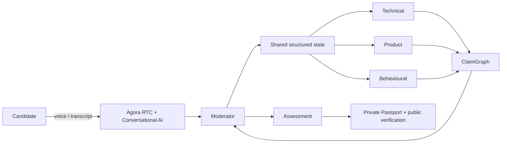

# EchoPanel

Adaptive, multi-agent interview rooms where candidate answers drive the next question. The polished MVP prioritizes the live **ClaimGraph Crossfire** demo: technical evidence is accepted, missing business impact causes the Product interviewer to request the floor, and the assessment stays linked to evidence.

## Run locally

```bash
npm install
npm run dev
npm run test
npm run typecheck
npm run build
```

Open `http://localhost:3000`. The deterministic judge-ready flow is at `/demo`; it runs without external services. The real Agora path is `/live` and never falls back to simulated audio. Demo candidate: **Alex Sharma**, target role: **Software Engineer**. Demo mode uses the fixed local HR session; database mode uses real Better Auth accounts created with the bootstrap command below.

## Environment

Copy `.env.example` to `.env.local`. `AGORA_APP_ID`, `AGORA_APP_CERTIFICATE`, and `AGORA_PIPELINE_ID` are required for live Agora mode. `AGORA_AREA` is optional (`US`, `EU`, or `AP`; defaults to `US`) and `AGORA_CHANNEL_PREFIX` is optional. `AGORA_AGENT_TOKEN` is not consumed by the current official SDK path because `agora-agents` generates ConvoAI auth from the App ID and App Certificate. Job-platform adapters return a verification-link fallback until official approval and credentials exist.

## Phase 2B/2C/2D recruitment database

Phase 2B adds the persistent careers and HR workflow, including job management, interview scheduling/status/report linkage, and the email centre (templates, drafts, queues, and settings). Phase 2C adds a Resend adapter, a durable transactional email outbox and worker, signed delivery webhooks, and explicit hiring notifications. Phase 2D adds organization-scoped Google Calendar OAuth, encrypted token storage, a durable calendar outbox and worker, idempotent interview create/update/cancel, explicit attendee notification policy, and timezone/DST-safe scheduling. Select database mode explicitly:

```bash
APP_DATA_MODE=database
DATABASE_URL=postgresql://...
AUTH_SECRET=<at-least-32-random-characters>
NEXT_PUBLIC_APP_URL=http://localhost:3000
```

Demo remains the default. Database mode never falls back to demo data: missing configuration or a database failure returns an explicit service/configuration error. Demo data stays available at `/demo`, but production should run with `APP_DATA_MODE=database`; unauthenticated interview mutations are disabled when `NODE_ENV=production`.

Apply the schema, seed demo jobs/templates, and create the first HR owner:

```bash
npx prisma migrate deploy
npm run db:seed
BOOTSTRAP_ADMIN_EMAIL=owner@example.com \
BOOTSTRAP_ADMIN_PASSWORD='<12+ characters>' \
BOOTSTRAP_ADMIN_NAME='HR Owner' \
npm run bootstrap:admin
```

Then sign in at `/hr/login`. Candidates use `/careers`; applications are stored with an opaque public reference, validated CV files, and organization scoping. HR applicant lists, stage changes, notes, CV downloads, jobs, interviews, reports, and email records require a session and organization membership. Publishing a job exposes it to public careers; closing or drafting hides it. Scheduling persists the interview and moves the application to `Interview`. Completing an interview does not invent a report.

Email records persist. Composing can save a `Draft` or create a durable `Queued` outbox record. Delivery requires `EMAIL_PROVIDER=resend`, `EMAIL_MODE=test|live`, `RESEND_API_KEY`, `EMAIL_FROM`, and a running `email:worker`; without them the UI reports the provider as not configured and nothing is delivered. Google Calendar synchronization is configured separately and is disabled by default; interviews are never shown as calendar-synced until the calendar worker records success, and that success confirms the event change rather than attendee email delivery.

Phase 2C provider lifecycle: `Draft -> Queued -> Sending -> Sent` when Resend accepts the message. `Delivered`, `Bounced`, and `Complained` require a verified webhook at `POST /api/webhooks/resend` using `EMAIL_WEBHOOK_SECRET`; `Sent` never implies delivery. Definite transient failures retry with bounded backoff, permanent failures stop, and an ambiguous send is marked `Failed` with `failureCode=AMBIGUOUS_SEND` and is never retried automatically to avoid duplicates. Test mode redirects all mail to `EMAIL_TEST_RECIPIENT`.

Run the email worker separately from the web process:

```bash
EMAIL_PROVIDER=resend
EMAIL_MODE=test
RESEND_API_KEY=replace-me
EMAIL_FROM='Talent Team <talent@example.com>'
EMAIL_TEST_RECIPIENT=you@example.com
EMAIL_WEBHOOK_SECRET=whsec_replace-me
npm run email:worker
```

The worker claims with `FOR UPDATE SKIP LOCKED`, sends with a provider idempotency key, recovers expired sends as ambiguous, and exposes optional `/health` and `/ready` endpoints with `EMAIL_WORKER_HEALTH_PORT`. Organization scoped stage notifications, interview invitations/reschedules/cancellations, 24-hour reminders, application receipts, offers, and rejections are inserted in the same transaction as the business change; they are queued only when explicitly requested. Failed, non-ambiguous sends can be requeued from the email detail view. No live Resend credentials or verified sender domain were available, so real delivery is unverified.

Phase 2D Google Calendar synchronization requires `CALENDAR_PROVIDER=google`, `GOOGLE_CALENDAR_CLIENT_ID`, `GOOGLE_CALENDAR_CLIENT_SECRET`, `GOOGLE_CALENDAR_REDIRECT_URI`, and `CALENDAR_TOKEN_ENCRYPTION_KEY` (base64-encoded 32 bytes). The redirect URI must exactly match the Google OAuth client; production requires HTTPS. Generate a key once with:

```bash
node -e "console.log(require('crypto').randomBytes(32).toString('base64'))"
```

Connect or disconnect from `/hr/schedule`, then run the calendar worker separately:

```bash
CALENDAR_PROVIDER=google
npm run calendar:worker
```

OAuth uses PKCE S256, a one-time 10-minute state bound to the HR user/organization/session, and the `calendar.events` plus `openid email` scopes. Access and refresh tokens are encrypted with AES-256-GCM using organization/provider-specific AAD; keep `CALENDAR_TOKEN_ENCRYPTION_KEY_PREVIOUS` while rotating, because refresh re-encrypts both tokens with the current key. The worker claims durable `CalendarEvent` rows with conditional version-matched updates and leases, recovers interrupted leases, retries transient failures with bounded backoff, uses deterministic event IDs so duplicate creates fetch the existing event after Google returns `409`, and exposes optional `/health`, `/live`, `/healthz`, `/ready`, and `/readyz` endpoints with `CALENDAR_WORKER_HEALTH_PORT`. Scheduling and rescheduling accept an explicit IANA timezone; the UI converts wall-clock time with DST-gap rejection instead of browser-local date parsing. Email and Google Calendar attendee notifications are separate opt-in choices (`sendUpdates=none|all`), and manual retry is available for failed or skipped events. No live Google OAuth client, redirect URI, or verified calendar account was available, so real synchronization remains unverified.

CV files are private and stored under `CV_STORAGE_DIR` (default `var/cv-storage`). Uploads are checked by file signature and enqueue a durable `CvScanJob` in the same database transaction. The request returns as soon as the application is stored; it never waits for malware scanning. The default policy only allows `CLEAN` downloads. `PENDING`, `INFECTED`, `SCAN_FAILED`, and `UNSCANNED` are blocked; `CV_ALLOW_UNSCANNED_DOWNLOADS=true` may permit only `UNSCANNED` files in non-production development.

A real ClamAV service is included in `compose.phase2a.yml`. Start it with PostgreSQL, configure the scanner, and run the worker:

```bash
docker compose --env-file .env.postgres.local -f compose.phase2a.yml up -d postgres clamav
CV_SCANNER_PROVIDER=clamav
CV_CLAMAV_HOST=127.0.0.1
CV_CLAMAV_PORT=3310
npm run cv:worker
```

The worker claims jobs with `FOR UPDATE SKIP LOCKED`, renews leases, recovers abandoned `RUNNING` jobs, and retries failed scans with exponential backoff (maximum 5 attempts). `INFECTED` files are quarantined and their stored bytes deleted. The worker shuts down gracefully on `SIGINT`/`SIGTERM` and can expose local health endpoints with `CV_WORKER_HEALTH_PORT` (`/health`, `/ready`). Use `npm run cv:scan-retry -- --requeue-failed` for a one-shot backfill or to requeue terminal failures. The integration uses ClamAV INSTREAM and fails closed on connection errors, timeouts, malformed responses, or scanner failures. An alternative HTTP scanner can be configured with `CV_SCANNER_PROVIDER=http`, `CV_SCANNER_URL`, and optional `CV_SCANNER_TOKEN`; it must return `{"status":"clean"}` or `{"status":"infected"}`.

Sensitive routes use a PostgreSQL-backed shared rate limiter, so limits hold across processes and restarts. Storage failures fail closed with HTTP 503 instead of allowing the request. `TRUSTED_PROXY_HEADERS=true` (or `RATE_LIMIT_TRUST_PROXY=true`) is required before `X-Forwarded-For`/`X-Real-IP` are trusted; otherwise the limiter uses a hashed client fingerprint. Limits can be tuned with `RATE_LIMIT_*_MAX` and `RATE_LIMIT_SECRET` (or `AUTH_SECRET`). Expired buckets are cleaned up by the worker with `RATE_LIMIT_RETENTION_HOURS`.

`GET /api/health/live` reports process liveness. `GET /api/health/ready` returns 503 only when a required dependency (database or private CV storage) is unavailable; scanner outages are reported as `degraded`. Responses include the request ID propagated by middleware. Logs are single-line JSON with request IDs, and sensitive fields, email addresses, credentials, database URLs, and CV content are redacted.

`npm test` covers demo behavior, database configuration, durable scanning, rate limiting, observability, public-form security, Phase 2B job/interview/email persistence, Phase 2C outbox retries, webhook verification/ordering, explicit notifications, and ambiguous-send handling, and Phase 2D timezone/DST conversion, token encryption/rotation, calendar create/update/cancel/retry, OAuth state, and reconnect backfill with fake providers. Database tests are opt-in and require a disposable PostgreSQL database:

```bash
TEST_DATABASE_URL=postgresql://... npm test
```

The browser E2E suite runs against an isolated `_e2e` database and storage directory, builds into `.next-e2e`, and starts the app on `3201`, a deterministic test scanner on `3311`, and a real `cv-worker` on `3312`. Copy the E2E block from `.env.example` into ignored `.env.e2e.local`, then run:

```bash
npm run test:e2e
```

The seven Playwright scenarios cover candidate submission, asynchronous clean scanning and download, explicitly confirmed stage changes and notes, infected CV blocking, duplicate submission, validation errors, recruiter authentication, organization isolation, explicit unavailable-data behavior, Phase 2B/2C job publishing, scheduling, honest report absence, and durable queued email, plus the Phase 2D disconnected Google Calendar states. The UI polls briefly while a scan is `PENDING`. The E2E scanner is deterministic, calendar is forced disabled, and no email/calendar worker or provider is started, so queued email and calendar work remain pending. Real ClamAV verification is performed separately with `npm run test:scanner:real` and `CV_CLAMAV_INTEGRATION=1`.

GitHub Actions runs typecheck, lint, unit tests and the production build; PostgreSQL integration tests with migrations; the Playwright suite; and a real-ClamAV job using a ClamAV service container.

## Agora configuration

1. In Agora Console, create/select a project with an App Certificate and enable Conversational AI Engine (for older projects, verify it on the RTC Services page).
2. Publish an AI Studio pipeline and place its ID in `AGORA_PIPELINE_ID`. Configure its STT, LLM, and TTS providers in the Console; Agora-managed models need no vendor key, while BYOK values belong only in the server environment/pipeline configuration.
3. Set `AGORA_APP_ID`, `AGORA_APP_CERTIFICATE`, and `AGORA_PIPELINE_ID` in `.env.local`, then run `npm run dev` and open `/live`.

`/api/agora/token` issues a real RTC+RTM token with `RtcTokenBuilder.buildTokenWithRtm`; `/api/agora/start` starts a real `agora-agents` Conversational AI session; `/live` joins RTC, publishes a microphone track, plays remote agent audio, and consumes RTM transcript/state events. The App Certificate never reaches the browser.

## Architecture



## Implemented endpoints

`GET /api/agora/session`, `POST /api/agora/start`, `/stop`, `/token`, and `POST /api/integrations/{linkedin|naukri|jobhai}/share` provide validated lifecycle and integration-fallback boundaries. OAuth/platform posting is not claimed or simulated.

Phase 2B/2C/2D APIs: `GET /api/careers/jobs`, `GET /api/careers/jobs/[id]`, `POST /api/careers/applications`, `GET /api/careers/applications/[reference]`, `GET /api/hr/applications`, `GET/PATCH /api/hr/applications/[id]`, `POST /api/hr/applications/[id]/stage`, `POST /api/hr/applications/[id]/notes`, `GET /api/hr/cv/[id]`, `GET/POST /api/hr/jobs`, `GET/PATCH /api/hr/jobs/[id]`, `PATCH /api/hr/jobs/[id]/status`, `GET/POST /api/hr/interviews`, `GET/PATCH /api/hr/interviews/[id]`, `GET /api/hr/interviews/options`, `POST /api/hr/interviews/[id]/cancel`, `POST /api/hr/interviews/[id]/complete`, `GET/POST /api/hr/interviews/[id]/assessment`, `GET/POST /api/hr/email/messages`, `GET /api/hr/email/messages/[id]`, `POST /api/hr/email/messages/[id]/retry`, `GET/POST /api/hr/email/templates`, `GET/PATCH /api/hr/email/templates/[id]`, `GET/PATCH /api/hr/email/settings`, `GET/DELETE /api/hr/calendar/connection`, `POST /api/hr/calendar/connect`, `GET /api/hr/calendar/google/callback`, `POST /api/hr/calendar/events/[id]/retry`, and `POST /api/webhooks/resend`. Better Auth is mounted at `/api/auth/[...all]`.

## Live-Agora readiness

`/live` is the credential-gated real voice path. It issues an RTC+RTM token, starts an Agora Conversational AI Engine session from the published pipeline, joins the browser to RTC, publishes a local microphone track, plays the agent's remote audio, and renders RTM transcript/state events. The VAD configuration enables candidate interruption (`interrupt_duration_ms: 160`), but actual interruption quality must be tested with the selected published pipeline.

The multi-agent ClaimGraph, speaker handoffs, adaptive difficulty, and final report remain deterministic demo features at `/demo`. They are not yet connected to live RTM transcript finalization or to a tool-enabled orchestrator that can change the running agent's instructions/persona. Do not present them as live Agora orchestration until that bridge is implemented and tested.

## Governance

Assessments are AI-assisted and intended for human review. The public verification page deliberately excludes transcript text. No scraping, biometric/emotion scoring, or claims of autonomous hiring decisions are made.
